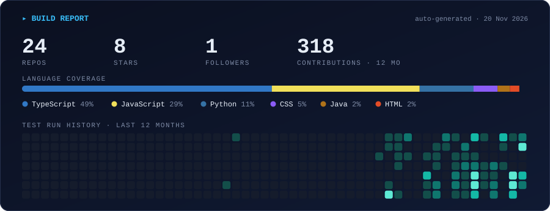

<div align="center">



<br/>

[](https://saif.dev)
[](https://www.linkedin.com/in/saif-al-saad-326864275/)
[](mailto:alsaad15062002@gmail.com)
[](https://www.facebook.com/saif.al.saad.195251)
[](https://www.instagram.com/saifal_saad/)

</div>

---

## `Whoami`

I'm a **Software Engineering** student at **Daffodil International University**, majoring in **Software Quality Assurance & Testing**. I build full-stack projects, and I'm just as interested in the tests and automation that prove they work.

```yaml
Name:      Saif Al Saad
Studying:  BSc Software Engineering @ Daffodil International University
Major:     Software Quality Assurance & Testing
Daily:     [manual testing, bug reporting, agile testing, full-stack builds]
Learning:  [Playwright, API testing, CI/CD, system design]
Motto:     Always learning, experimenting, improving.
```

---

## `Saif.spec` — what I can do

| Status | Capability | Evidence |
|:--:|:--|:--|
| ✅ **PASS** | Manual testing | Test planning, test case design, bug reports |
| ✅ **PASS** | Agile testing | *Agile Testing* and *Agile Testing Lab* coursework |
| ✅ **PASS** | Full-stack development | React, Node/Express, SQL databases, Supabase, Firebase (see projects below) |
| 🟡 **RUNNING** | UI automation | Playwright in Python with the Page Object Model |
| 🟡 **RUNNING** | API testing | Postman collections and request validation |
| 🟡 **RUNNING** | CI/CD | Pipelines with GitHub Actions (this profile already runs one ↓) |

---

## `Skill-Matrix` — technical skills

| Domain | Competencies & Technologies |
|:--|:--|
| 🧪 **Testing & QA** | `Agile Testing` `Manual Testing` `Test Case Design` `Test Execution` `Automation` `Postman` |
| 💻 **Programming** | `Python` `Java` `JavaScript` `TypeScript` `C` `OOP` |
| 🌐 **Web Development** | `React` `Node.js` `Express.js` `HTML5` `CSS3` `Vite` `Tailwind CSS` |
| 🗄️ **Databases** | `MySQL` `Firebase` `Supabase` |
| 🤖 **Machine Learning** | `Logistic Regression` `Decision Trees` `KNN` `K-Means Clustering` `Random Forest` |
| 🛠️ **Tools** | `Git` `GitHub` `Ollama` `Selenium` `Playwright` |

---

## `Test-Cases/` — projects

| Case ID | Project | Focus & Implementation | Tech Stack | Reference |
|:--:|:--|:--|:--|:--:|
| `TC-01` | [**🛋️ RoomCraft**](https://github.com/Saif-AlSaad/VirtualRoom)<br/><sub>3D Room Planner</sub> | Interactive browser-based 3D room and furniture planner with real-time layout & positioning | `React` `TypeScript`<br/>`Three.js` `Zustand` | [**Repo →**](https://github.com/Saif-AlSaad/VirtualRoom) |
| `TC-02` | [**💰 FinTrack**](https://github.com/Saif-AlSaad/FinTrack)<br/><sub>Personal Finance & AI</sub> | Expense & budget manager with cloud sync and an Ollama-powered local AI layer for anomaly detection | `JavaScript` `Supabase`<br/>`Ollama` `Tailwind CSS` | [**Repo →**](https://github.com/Saif-AlSaad/FinTrack) |
| `TC-03` | [**🏥 Apex HMS**](https://github.com/Saif-AlSaad/Hospital-Management-System)<br/><sub>Hospital System</sub> | Hospital management system on raw parameterized SQL (37 tables in 3NF with stored procedures & triggers) | `React` `Express`<br/>`PostgreSQL` `Raw SQL` | [**Repo →**](https://github.com/Saif-AlSaad/Hospital-Management-System) |
| `TC-04` | [**💼 JobHub**](https://github.com/Saif-AlSaad/JobHub)<br/><sub>Placement Portal</sub> | Collaborative university platform connecting students with career and job placement opportunities | `JavaScript` `Node.js`<br/>`Express` `MySQL` | [**Repo →**](https://github.com/Saif-AlSaad/JobHub) |
| `TC-05` | [**🎮 Wall-Rush**](https://github.com/Saif-AlSaad/Wall-Rush)<br/><sub>Interactive Game</sub> | Fast-paced browser arcade runner featuring dynamic obstacle avoidance and collision mechanics | `JavaScript` `HTML5`<br/>`CSS3` `Canvas` | [**Repo →**](https://github.com/Saif-AlSaad/Wall-Rush) |
| `TC-06` | [**🌐 Portfolio**](https://github.com/Saif-AlSaad/Portfolio)<br/><sub>saif.dev</sub> | Personal developer portfolio site featuring QA testing specs, project archives, and contact portal | `HTML5` `CSS3`<br/>`JavaScript` `TypeScript` | [**Live ↗**](https://saif.dev)<br/>[**Repo →**](https://github.com/Saif-AlSaad/Portfolio) |

---

## `build-report` — live from my GitHub

<div align="center">

</div>

<sub>Generated by a GitHub Action every 6 hours, with no third-party stats service involved. Source: [`scripts/update_profile.py`](scripts/update_profile.py)</sub>

### Latest pushes

<!--RECENT:START-->
| Repo | What it is | Lang | Last push |
|:--|:--|:--|:--|
| [`JobHub`](https://github.com/Saif-AlSaad/JobHub) | — | JavaScript | 19 Nov 2026 |
| [`Hospital-Management-System`](https://github.com/Saif-AlSaad/Hospital-Management-System) | — | JavaScript | 13 Nov 2026 |
| [`Portfolio`](https://github.com/Saif-AlSaad/Portfolio) | — | TypeScript | 01 Nov 2026 |
| [`HungryMan`](https://github.com/Saif-AlSaad/HungryMan) | A game where user need to hunt bugs and report them.  | TypeScript | 29 Oct 2026 |
| [`MistWood-`](https://github.com/Saif-AlSaad/MistWood-) | — | TypeScript | 29 Oct 2026 |
<!--RECENT:END-->

---

## `toolchain`

| | |
|:--|:--|
| **Languages** |        |
| **Testing** |     |
| **Web & UI** |      |
| **Databases** |     |
| **Tools & AI** |      |

---

## `backlog.md` — current sprint

- [x] Complete Agile Testing and Agile Testing Lab coursework
- [x] Ship FinTrack with cloud sync and a local AI layer
- [ ] Build a Playwright (Python) suite with the Page Object Model
- [ ] Write Postman API test collections and run them in CI
- [ ] Land a QA / Software Testing internship

---

<div align="center">

</div>
